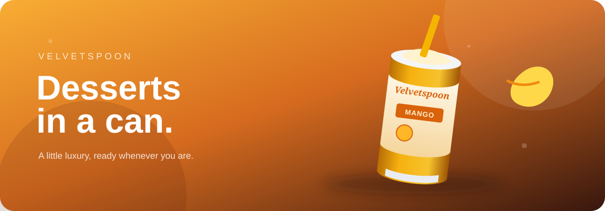

<div align="center">



# Velvetspoon

### Desserts in a can, served with a little theatre.

An immersive, responsive product showcase for chilled desserts — built as a single-page experience with animated product transitions, interactive details, and a working cart drawer.

<a href="http://127.0.0.1:8000/">View locally</a>

</div>

## Highlights

- Animated product carousel for Mango, Chocolate, and Berry Cheesecake
- Interactive quantity controls and cart drawer
- Product detail panels with flavor information
- Responsive desktop and mobile layouts
- Reduced-motion support through `prefers-reduced-motion`
- Lightweight single-file implementation with inline SVG product artwork

## Built with


## Run the project

No build step is required.

```bash
git clone https://github.com/<your-username>/velvetspoon-dessert-showcase.git
cd velvetspoon-dessert-showcase
npx serve .
```

Open the local URL printed by the server. You can also open `index.html` directly in a browser.

## Project structure

```text
.
├── assets/
│   └── velvetspoon-hero.svg
├── index.html
└── README.md
```

## Product menu

| Flavor | Description |
| --- | --- |
| Alphonso Cream | Silky mango cream with a buttery crumble |
| Midnight Cocoa | Belgian chocolate mousse with roasted coffee |
| Berry Cheesecake | Vanilla cheesecake, almond base, and blueberry compote |

## License

This project is a personal showcase concept. Add a license before distributing it publicly.

